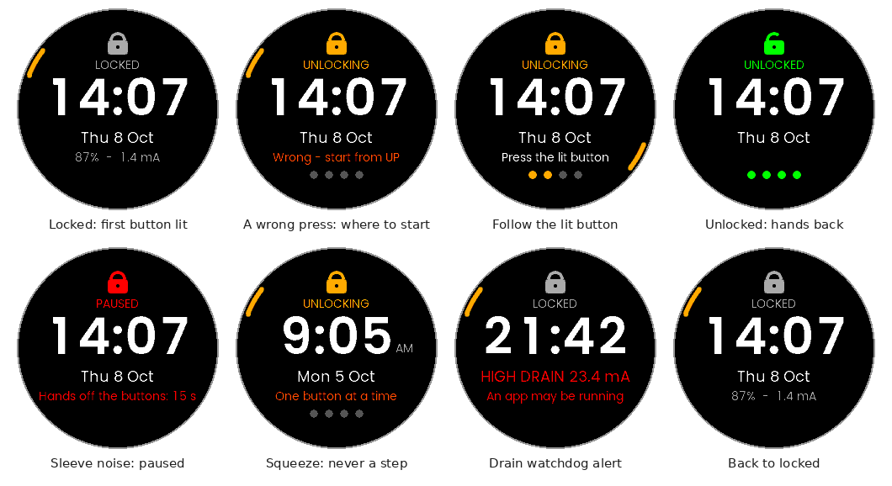

# ButtonLock

A lock screen for the UNA Watch. While it is up, every button press goes to it,
so a sleeve, a cuff or a glove cannot start an activity. It unlocks only for a
deliberate sequence, and the screen lights each button to press next. Why it
exists and how well it works: [`docs/STUDY.md`](../../docs/STUDY.md); why the
sequence is four presses: [`docs/sequence-study.md`](../../docs/sequence-study.md).

Buttons have UNA's names: **UP** (top left), **SELECT** (top right), **DOWN**
(bottom left) and **BACK** (bottom right).



## Using it

- **Locked** looks like a watch face: time, date, battery, and the measured
  battery current (an experiment aid; `showCurrent`).
- **To unlock**, press the button whose bezel arc is lit, then each newly lit
  one, one at a time: by default **UP SELECT BACK DOWN**, once round the case
  clockwise from the top left. Keep your fingers off the buttons for a moment
  before the first press: it only counts after a short pause.
- **"Hands off the buttons: 15 s"** means unlocking is paused after several wrong
  attempts, which is what a sleeve does. Pull the sleeve back and leave the
  buttons alone until the count ends. Under a tight cuff this pause, not the
  number of presses, is most of the wait.
- **It relocks itself** 2 minutes after an unlock (`relockMinutes`). It also
  locks at start-up (`lockAtBoot`). To lock at once, open ButtonLock from
  Utilities (UP from the watch face, scroll to it, SELECT).
- **"HIGH DRAIN"** means the battery current has stayed above 8 mA for 10 minutes
  while locked: something, probably an activity opened before the lock went up,
  is still running. Unlock, find it (the activity list) and close it.

## Settings

Edited from the phone, if the companion app offers it for sideloaded apps, or as
`app_config.json` in the app's folder on the watch (start from
[`Output/app_config.example.json`](Output/app_config.example.json)). Changes
apply the next time the service starts, i.e. after a power cycle.

| Field | Default | |
|---|---|---|
| `unlockSequence` | `UP SELECT BACK DOWN` | 3–8 steps, at least three different buttons, none twice in a row; the names L1, R1, R2, L2 also work. An invalid value falls back to the default. `UP SELECT BACK` is quicker and fine without a tight sleeve; each step fewer makes an accidental unlock about ten times likelier |
| `relockMinutes` | `2` | 0 = only when opened by hand |
| `lockAtBoot` | `true` | |
| `notificationsWhileLocked` | `true` | |
| `drainAlertMilliamps` | `8` | 0 = off |
| `drainWindowMinutes` | `10` | |
| `showCurrent` | `true` | |

## Layout

```
Software/Libs/Core/ButtonLock/   pure C++, no SDK: the logic, host-tested in tests/
    Sequence.*                 buttons, the sequence and its parser
    UnlockDetector.*           the unlock rules
    LockController.*           when the lock goes up (boot, relock, lost, hidden)
    DrainWatchdog.*            the current averager and alert
Software/Libs/Header,Sources/  the service (Service.*), the message contract
                               (Commands.hpp) and the config table (AppConfigFields.*)
Software/Apps/LVGL-GUI/        the GUI: Model, LockScreen, fonts
    simulator/                 PC simulator, its scripts, and the service harness
Software/Apps/ButtonLock-CMake/  the watch build
Output/app-manifest.json       package metadata and the config fields
```

## Build and test

From the repository root:

```bash
tools/bootstrap.sh && source tools/env.sh
tools/build.sh                 # dist/ButtonLock_0.2.0.uapp
tools/test.sh --sim            # unit tests, jacket model, simulator, service harness
```

The PC simulator on its own (keys 1–4 are UP, DOWN, SELECT, BACK):

```bash
cd apps/ButtonLock/Software/Apps/LVGL-GUI/simulator
cmake -S . -B build-ninja -G Ninja && cmake --build build-ninja
cd build/bin && ./ButtonLockSimulator
```
